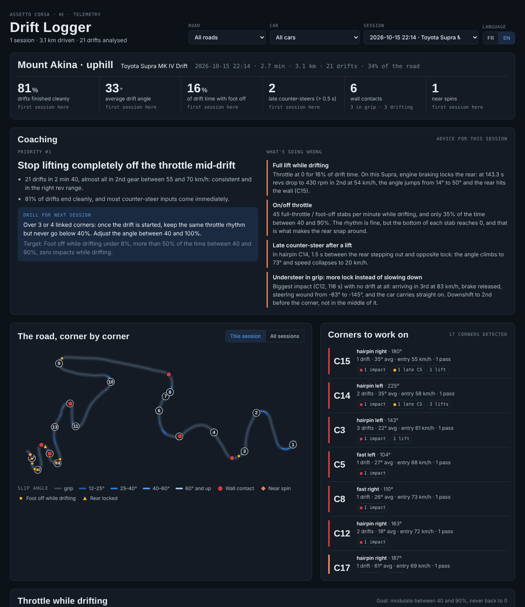

# Drift Logger

Enregistreur de télémétrie et coach de pilotage pour le drift et le touge dans **Assetto Corsa**.

Une appli dans le jeu enregistre l'état de la voiture environ 90 fois par seconde. Un script Python repère ensuite chaque glisse, choc, quasi tête-à-queue et lever de pied, reconstitue les virages de la route à partir de la trajectoire, et suit la progression d'une session à l'autre. Le tout aboutit à un tableau de bord HTML.

*[English version](README.md)*



## Ce qui est mesuré

| Indicateur | Détection |
|---|---|
| Glisses | angle de dérive au-delà de 12°, à plus de 20 km/h, pendant au moins 0,4 s |
| Chocs | pic d'accélération au-delà de 3,5 g, classé *en grip* ou *en glisse* |
| Quasi tête-à-queue | angle de dérive au-delà de 75° |
| Pied levé en glisse | accélérateur sous 5 % pendant plus de 0,15 s en glisse |
| Arrière bloqué | régime qui tombe sous 1 500 tr/min en prise (le frein moteur bloque l'arrière) |
| Contre-braquage tardif | plus de 0,5 s entre le départ de l'arrière (15°) et le contre-braquage |
| À-coups d'accélérateur | passage du plein gaz au pied levé, ou l'inverse, en moins de 0,35 s |
| Dosage de l'accélérateur | part du temps en glisse pied levé / bas / dosé (40–90 %) / à fond |

Chaque glisse est aussi décomposée : comment elle a été lancée (enchaînement, appel-contre-appel, clutch kick, freinage, lever de pied, gaz), comment elle a été tenue, et comment elle s'est terminée. Un contact léger en sortie (moins de 10 km/h perdus) compte comme une réussite. Chaque passage dans chaque virage est comparé : réussite par virage et par technique, vitesse d'entrée et point de freinage des passages réussis et ratés, réflexe dominant, et cause probable de chaque raté (entrée trop rapide, pied levé, arrière bloqué, contre-braquage tardif, trop d'angle, placement).

Les virages sont détectés à partir de la courbure de la trajectoire (rayon inférieur à 90 m) et numérotés selon leur position le long de la route : un virage garde son numéro d'une session à l'autre. Chaque virage a ses statistiques cumulées (passages, glisses, angle moyen, chocs, tête-à-queue) et un score de difficulté.

## Organisation

```
drift_logger/                  dossier à copier dans assettocorsa/apps/python/
├── drift_logger.py            appli du jeu (Python 3.3, celui d'Assetto Corsa)
├── logs/                      CSV écrits par l'appli (créé au premier REC)
└── analysis/
    ├── analyse.py             logs -> sessions/, tracks/, history.json, report.json
    ├── technique.py           initiation, ending, score and causes of each drift
    ├── corner_report.py       corner-by-corner and per-technique comparisons
    ├── build_dashboard.py     -> dashboard.html
    ├── update_dashboard.bat   one-click update (Windows)
    ├── dashboard_template.html
    └── requirements.txt
```

## Utilisation

1. Copier `drift_logger/` dans `steamapps/common/assettocorsa/apps/python/`.
2. Dans Content Manager : *Settings → Assetto Corsa → Apps*, cocher **drift_logger**.
3. En piste, ouvrir **Drift Logger** depuis la barre d'applis à droite, cliquer sur **REC**, rouler, puis **STOP**.
4. Sous Windows, double-cliquer sur `analysis/update_dashboard.bat` (installe numpy/pandas si besoin, lance l'analyse et ouvre le tableau de bord), ou à la main :

```bash
cd drift_logger/analysis
pip install -r requirements.txt
python analyse.py
python build_dashboard.py
```

5. Ouvrir `analysis/dashboard.html` dans un navigateur. L'interface passe du français à l'anglais.

Les conseils de coaching sont lus dans `analysis/coaching.json` (une entrée par session, textes `fr` et `en`). Les données enregistrées (`logs/`, `sessions/`, `tracks/`, `history.json`, `coaching.json`, `dashboard.html`) sont ignorées par git.

## Canaux enregistrés

vitesse, accélérateur, frein, embrayage, rapport, régime, angle de volant, accélérations sur 3 axes, vitesse locale, vitesses de lacet / tangage / roulis, angle et taux de glissement de chaque roue, charge sur chaque roue, position le long de la route, position dans le monde.

## Notes

- Testé avec Assetto Corsa, Content Manager et Custom Shaders Patch.
- L'angle de dérive est calculé à partir de la vitesse locale de la voiture : `atan2(vx, vz)`.
- Les seuils sont des constantes en haut de `analyse.py`.
