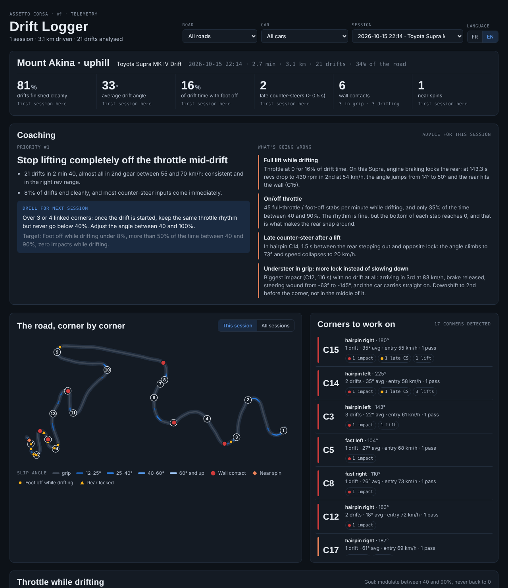

# Drift Logger

Enregistreur de télémétrie et coach de pilotage pour le drift et le touge dans **Assetto Corsa**.

Une appli dans le jeu enregistre l'état de la voiture environ 90 fois par seconde. Un script Python repère ensuite chaque glisse, choc, quasi tête-à-queue et lever de pied, reconstitue les virages de la route à partir de la trajectoire, et suit la progression d'une session à l'autre. Le tout aboutit à un tableau de bord HTML.

*[English version](README.md)*



## Ce qui est mesuré

| Indicateur | Détection |
|---|---|
| Glisses | angle de dérive au-delà de 12°, à plus de 20 km/h, pendant au moins 0,4 s |
| Chocs | pic d'accélération au-delà de 3,5 g, classé *en grip* ou *en glisse* |
| Quasi tête-à-queue | angle de dérive au-delà de 75° |
| Pied levé en glisse | accélérateur sous 5 % pendant plus de 0,15 s en glisse |
| Arrière bloqué | régime qui tombe sous 1 500 tr/min en prise (le frein moteur bloque l'arrière) |
| Contre-braquage tardif | plus de 0,5 s entre le départ de l'arrière (15°) et le contre-braquage |
| À-coups d'accélérateur | passage du plein gaz au pied levé, ou l'inverse, en moins de 0,35 s ; le lever de pied qui lance une glisse n'est pas compté |
| Dosage de l'accélérateur | part du temps en glisse pied levé / bas / dosé (40–90 %) / à fond |

Chaque glisse est aussi décomposée : comment elle a été lancée (enchaînement, appel-contre-appel, clutch kick, freinage, lever de pied, gaz), comment elle a été tenue, et comment elle s'est terminée. Un contact léger en sortie (moins de 10 km/h perdus) compte comme une réussite. Chaque passage dans chaque virage est comparé : réussite par virage et par technique, vitesse d'entrée et point de freinage des passages réussis et ratés, réflexe dominant, et cause probable de chaque raté (entrée trop rapide, pied levé, arrière bloqué, contre-braquage tardif, trop d'angle, placement).

## Replay

La voiture est redessinée vue du dessus : un rectangle avec la vitre claire à l'avant, les roues avant qui suivent le volant, et une flèche pour la vraie direction du déplacement. L'écart entre la flèche et le nez, c'est l'angle de dérive.

- **Onglet Session → Replay** : tout le run avec une caméra qui suit la voiture (orientée selon la route ou carte fixe), une mini-carte, les contours de la voiture juste avant, et en direct vitesse, angle, rapport, pédales et volant. Chaque glisse du tableau a un bouton ▶, et un clic sur les courbes de télémétrie place le replay à cet instant.
- **Onglet Virages → Rejouer le virage** : jusqu'à trois passages du même virage partent ensemble à l'entrée, pour voir qui freine plus tôt, qui met plus d'angle, qui tape. *Silhouettes* dessine la voiture toutes les 0,3 s.

La route est dessinée avec ses vrais bords, lus dans la ligne IA de la piste (`ai/fast_lane.ai` stocke la largeur de route de chaque côté). Le dossier d'Assetto Corsa est cherché aux emplacements Steam habituels, ou via la variable `AC_ROOT`. Sans lui, une bande autour de la trajectoire est dessinée à la place. Certaines pistes de mods laissent ces largeurs à zéro : la route est alors dessinée sur 8 m autour de la ligne IA, avec des bords en pointillés, et les chocs ne sont pas comparés à ces bords.

## Onglet Classement

Toutes les sessions dans un tableau triable, avec une note sur 100 (40 % glisses réussies, 40 % score moyen des glisses, 10 % chocs francs par km, 10 % sous-virage) et un niveau : modèle, bonne, moyenne, à revoir. La meilleure note pour chaque voiture sur chaque route est marquée comme référence. Les sessions peuvent être mises en favoris (gardés dans le navigateur) et filtrées par sens (montée / descente), comme le reste du dashboard.

En dessous, les **meilleurs passages** : le record de chaque virage (la meilleure glisse réussie à cet endroit, avec le nombre de sessions qui l'ont réussi) ou le top 30 de tous les passages. Les glisses à 90 ou plus sont à égalité, et la plus grosse et la plus longue gagne. Un clic sur une ligne rejoue le passage. Le détail de chaque virage, dans l'onglet Virages, affiche aussi son record.

## Onglet Avancé

Lit la courbe de puissance et le poids de la voiture dans `content/cars/<voiture>/ui/ui_car.json` et explique pourquoi une glisse tient ou meurt :

- chaque glisse placée sur la courbe de puissance à son régime moyen, avec la zone utile (≥ 85 % de la puissance max) ;
- pour chaque rapport, les vitesses où le moteur est dans cette zone, avec la vitesse d'entrée de chaque glisse : on voit les plages où aucun rapport ne convient ;
- un calculateur de G (latéral contre longitudinal, coloré par angle de dérive) avec les G max en latéral, au freinage et en accélération ;
- les départs, y compris avortés (l'arrière a décroché de 6 à 12° puis s'est raccroché), pour que la réussite de chaque technique compte toutes les tentatives ;
- freinage dégressif : chaque entrée d'épingle ou de virage serré reçoit une note sur 100 (frein encore là au braquage, tenu en tournant, relâché progressivement, l'avant mord sans sous-virer, pas de roues avant bloquées), un verdict avec un conseil, et une estimation de combien plus vite tu aurais pu entrer quand l'avant a mordu avec de l'adhérence en réserve ;
- sous-virage : les moments où les pneus avant glissent nettement plus que les arrière sans que la voiture dérive, avec ce que faisaient les pédales (accélérateur, pieds levés, freinage, roues avant bloquées), si le frein venait d'être relâché avant de tourner, et les secondes de sous-virage par virage ;
- talon-pointe : pour chaque rétrogradage, coup de gaz pendant le freinage ou non, frein tenu pendant le coup de gaz, durée du coup de gaz, écart entre le régime au relâcher de l'embrayage et le régime du nouveau rapport, et à-coup sur les roues arrière. Un rétrogradage qui bloque l'arrière et lance la glisse compte comme un lancement à part, *rétrogradage* ;
- pour chaque glisse : régime, part de la puissance max, patinage arrière, vitesse gagnée ou perdue par seconde, G moyen et temps volant en butée.

L'API Python d'AC ne donne pas le cap de la voiture : il est reconstruit en intégrant la vitesse de lacet, recalée en continu sur la direction de déplacement moins l'angle de dérive (environ 0,4° d'erreur médiane).

Les virages sont détectés à partir de la courbure de la trajectoire (rayon inférieur à 90 m) et numérotés selon leur position le long de la route : un virage garde son numéro d'une session à l'autre. Chaque virage a ses statistiques cumulées (passages, glisses, angle moyen, chocs, tête-à-queue) et un score de difficulté. Dans le dashboard, les virages peuvent être listés dans l'ordre de la route, les plus traîtres d'abord (le plus de passages ratés), ou par *meilleurs drifts* : une note de drift sur 100 faite de 40 % de passages glissés proprement, 30 % du score moyen de ces glisses, 15 % de l'angle moyen (35° = note maximale) et 15 % de la durée moyenne (2,5 s = note maximale). Elle suit les filtres de voiture, de route et de sens.

## Organisation

```
drift_logger/                  dossier à copier dans assettocorsa/apps/python/
├── drift_logger.py            appli du jeu (Python 3.3, celui d'Assetto Corsa)
├── logs/                      CSV écrits par l'appli (créé au premier REC)
└── analysis/
    ├── analyse.py             logs -> sessions/, tracks/, history.json, report.json
    ├── technique.py           initiation, ending, score and causes of each drift
    ├── corner_report.py       corner-by-corner and per-technique comparisons
    ├── build_dashboard.py     -> dashboard.html
    ├── update_dashboard.bat   one-click update (Windows)
    ├── dashboard_template.html
    └── requirements.txt
```

## Utilisation

1. Copier `drift_logger/` dans `steamapps/common/assettocorsa/apps/python/`.
2. Dans Content Manager : *Settings → Assetto Corsa → Apps*, cocher **drift_logger**.
3. En piste, ouvrir **Drift Logger** depuis la barre d'applis à droite, cliquer sur **REC**, rouler, puis **STOP**.
4. Sous Windows, double-cliquer sur `analysis/update_dashboard.bat` (installe numpy/pandas si besoin, lance l'analyse et ouvre le tableau de bord), ou à la main :

```bash
cd drift_logger/analysis
pip install -r requirements.txt
python analyse.py
python build_dashboard.py
```

5. Ouvrir `analysis/dashboard.html` dans un navigateur. L'interface passe du français à l'anglais.

Les conseils de coaching sont lus dans `analysis/coaching.json` (une entrée par session, textes `fr` et `en`). Les données enregistrées (`logs/`, `coach/`, `sessions/`, `tracks/`, `history.json`, `coaching.json`, `dashboard.html`) sont ignorées par git.

## Coach en jeu

La fenêtre Drift Logger affiche aussi un coach, même sans enregistrer. À 250 m de chaque virage, elle donne la fenêtre de vitesse à viser au début du virage (« V13 épingle G · cible 66-80 km/h »), puis « Freine dans 40 m » jusqu'au point de freinage. Pendant le freinage, ta vitesse s'affiche en vert dans la fenêtre, en orange si tu es trop vite, en bleu si tu es trop lent. Elle rappelle aussi combien de frein garder en tournant. Au début du virage, un verdict reste affiché 3,5 s : « Bon : 62 km/h », « Trop vite : +8 km/h », « freinage trop tôt de 20 m », « frein relâché avant de tourner »…

Les cibles viennent de tes propres passages réussis en glisse, voiture par voiture et route par route. `analyse.py` les écrit dans `coach/<voiture>__<route>.txt`, et l'app les relit dès qu'elles changent. Un virage n'a de cible qu'après au moins 2 glisses réussies : la fenêtre de vitesse couvre le quart central de ces passages, élargie de 3 km/h de chaque côté (8 km/h minimum). Le point de freinage tient compte de ta vitesse : c'est le plus loin entre le point de freinage qui a marché (médiane de tes débuts de freinage, s'il est à moins de 100 m) et la distance qu'il faut à cette voiture pour descendre de ta vitesse actuelle au milieu de la fenêtre, avec 70 % de son meilleur freinage mesuré et 0,3 s de réaction. Plus tu arrives vite, plus le « Freine dans » arrive tôt. Le verdict ne signale un freinage trop tard que si tu arrives trop vite, et trop tôt que si tu arrives trop lent. Le bouton **COACH** coupe ou rallume l'affichage, et `LANG` en tête de `drift_logger.py` passe les textes en anglais.

## Canaux enregistrés

vitesse, accélérateur, frein, embrayage, rapport, régime, angle de volant, accélérations sur 3 axes, vitesse locale, vitesses de lacet / tangage / roulis, angle et taux de glissement de chaque roue, charge sur chaque roue, position le long de la route, position dans le monde.

## Notes

- Testé avec Assetto Corsa, Content Manager et Custom Shaders Patch.
- L'angle de dérive est calculé à partir de la vitesse locale de la voiture : `atan2(vx, vz)`.
- Les seuils sont des constantes en haut de `analyse.py`.
