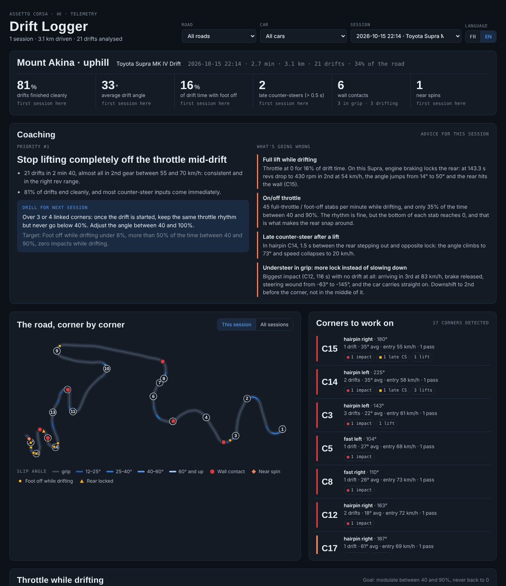

# Drift Logger

Telemetry recorder and driving coach for drifting and touge in **Assetto Corsa**.

An in-game app records the car's state about 90 times per second. A Python script then finds every drift, wall contact, near spin and throttle lift, rebuilds the road's corners from the car's path, and tracks progress from one session to the next. Everything ends up in a single HTML dashboard.

*[Version française](README.fr.md)*



## What it measures

| Metric | How it is detected |
|---|---|
| Drifts | body slip angle above 12° at more than 20 km/h for at least 0.4 s |
| Wall contacts | acceleration spike above 3.5 g, split into *in grip* and *while drifting* |
| Near spins | slip angle above 75° |
| Foot off while drifting | throttle below 5% for more than 0.15 s during a drift |
| Rear lock | engine speed collapsing below 1,500 rpm while in gear (engine braking locks the rear) |
| Late counter-steer | more than 0.5 s between the rear stepping out (15°) and opposite lock |
| Throttle stabs | full throttle to foot off, or back, in under 0.35 s; the lift-off that starts a drift is not counted |
| Throttle use | share of drift time spent off / low / modulated (40–90%) / flat out |

Each drift is also broken down by how it was started (transition, feint, clutch kick, braking, lift-off, power over), how it was held and how it ended. A light touch on exit (under 10 km/h lost) still counts as a success. Every pass through every corner is compared: success rate per corner and per technique, entry speed and braking point of successful vs failed passes, dominant reflex, and the most likely cause of each failure (too fast on entry, foot off, rear lock, late counter-steer, too much angle, line).

## Replay

The car is redrawn as a top-down rectangle: body, light window at the front, front wheels turned by the steering input, and an arrow for the real direction of travel. The gap between the arrow and the nose is the slip angle.

- **Session tab → Replay**: the whole run with a chase camera (following the road or fixed map), a mini-map, outlines of the car a moment earlier, and live speed, angle, gear, pedals and steering. Each drift in the table has a ▶ button, and clicking the telemetry traces moves the replay there.
- **Corners tab → Replay the corner**: up to three passes of the same corner start together at the corner entry, so you can see who brakes earlier, who carries more angle and who hits the wall. *Ghosts* draws the car every 0.3 s along each pass.

The road is drawn with its real edges, read from the track's AI line (`ai/fast_lane.ai` stores how far the road extends on each side). The Assetto Corsa folder is found in the usual Steam locations, or set `AC_ROOT`. Without it, a band around the driven line is drawn instead. Some track mods leave the side distances at zero: the road is then drawn 8 m wide around the AI line, with dashed edges, and impacts are not checked against those edges.

## Ranking tab

Every session in one sortable table with a score out of 100 (40% successful drifts, 40% average drift score, 10% hard impacts per km, 10% understeer) and a level: model, good, average, to review. The best score for each car on each road is marked as the reference. Sessions can be starred as favourites (kept in the browser) and filtered by direction (uphill / downhill) like the rest of the dashboard.

Below it, **best corner passes**: the record for each corner (the best successful drift ever there, with how many sessions managed it) or the top 30 passes overall. Drifts scoring 90 or more tie, and the bigger, longer one wins. Clicking a row replays that pass. Each corner's detail in the Corners tab also shows its record.

## Advanced tab

Reads the car's power curve and weight from `content/cars/<car>/ui/ui_car.json` and explains why drifts live or die:

- each drift placed on the power curve at its average revs, with the useful band (≥ 85% of peak power);
- for each gear, the speeds where the engine is in that band, with the entry speed of every drift, which shows speed ranges where no gear works;
- a G-force meter (lateral vs longitudinal, coloured by slip angle) with max lateral, braking and acceleration g;
- initiations including aborted ones (the rear stepped out 6 to 12° then gripped again), so the success rate of each technique counts every attempt;
- trail braking: every hairpin and tight-corner entry gets a score out of 100 (brake still on when turning in, held while turning, released progressively, front biting with no understeer, no front lock), a verdict with a tip, and an estimate of how much faster the entry could be when the front bit with lateral grip to spare;
- understeer: moments where the front tyres slide clearly more than the rears while the car isn't drifting, with what the pedals were doing (throttle, feet off, braking, front lock), whether the brake had just been released before turning in, and seconds of understeer per corner;
- heel-and-toe: for every downshift, whether the throttle was blipped while braking, whether the brake stayed pressed during the blip, the blip length, how close the revs were to the new gear's revs when the clutch bit, and how hard the rear wheels were jerked. A downshift that locks the rear and starts the drift counts as its own initiation, *downshift*;
- per drift: revs, share of peak power, rear wheelspin, speed gained or lost per second, average g and time with the steering wheel against its lock.

AC's Python API has no world heading, so it is rebuilt: the yaw rate is integrated and its slow drift is corrected with the direction of travel minus the slip angle (about 0.4° median error).

Corners are detected from the path's curvature (radius under 90 m) and numbered by their position along the track spline, so a corner keeps its number from one session to the next. Each corner gets cumulative stats (passes, drifts, average angle, impacts, spins) and a trouble score. In the dashboard the corners can be listed in road order, most treacherous first (most failed passes), or by *best drifts*: a drift note out of 100 made of 40% passes drifted cleanly, 30% average score of those drifts, 15% average angle (35° = full marks) and 15% average duration (2.5 s = full marks). It follows the car, road and direction filters.

## Layout

```
drift_logger/                  copy this folder to assettocorsa/apps/python/
├── drift_logger.py            in-game app (Python 3.3, Assetto Corsa's interpreter)
├── logs/                      CSV files written by the app (created on first REC)
└── analysis/
    ├── analyse.py             logs -> sessions/, tracks/, history.json, report.json
    ├── technique.py           initiation, ending, score and causes of each drift
    ├── corner_report.py       corner-by-corner and per-technique comparisons
    ├── build_dashboard.py     -> dashboard.html
    ├── update_dashboard.bat   one-click update (Windows)
    ├── dashboard_template.html
    └── requirements.txt
```

## Usage

1. Copy `drift_logger/` into `steamapps/common/assettocorsa/apps/python/`.
2. In Content Manager: *Settings → Assetto Corsa → Apps*, tick **drift_logger**.
3. On track, open **Drift Logger** from the right-hand app bar, press **REC**, drive, press **STOP**.
4. On Windows, double-click `analysis/update_dashboard.bat` (installs numpy/pandas if needed, runs the analysis and opens the dashboard), or run it by hand:

```bash
cd drift_logger/analysis
pip install -r requirements.txt
python analyse.py
python build_dashboard.py
```

5. Open `analysis/dashboard.html` in a browser. The interface switches between French and English.

Coaching notes are read from `analysis/coaching.json` (one entry per session, `fr` and `en` text). Your recorded data (`logs/`, `sessions/`, `tracks/`, `history.json`, `coaching.json`, `dashboard.html`) is ignored by git.

## Recorded channels

speed, throttle, brake, clutch, gear, rpm, steering angle, 3-axis acceleration, local velocity, yaw / pitch / roll rates, slip angle and slip ratio per wheel, load per wheel, position along the track spline, world position.

## Notes

- Tested with Assetto Corsa, Content Manager and Custom Shaders Patch.
- Slip angle is computed from the car's local velocity: `atan2(vx, vz)`.
- Thresholds are constants at the top of `analyse.py`.
